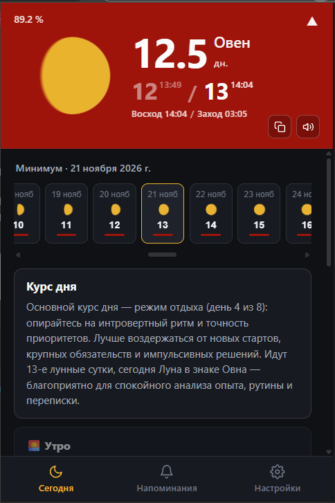
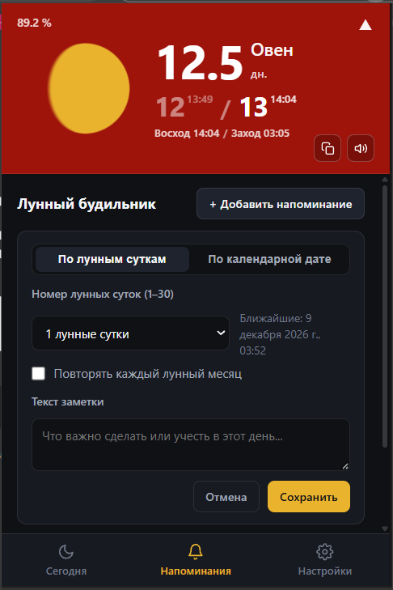
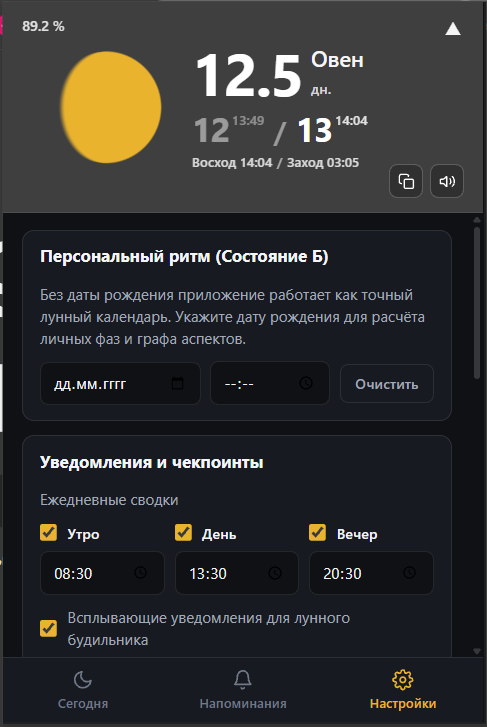

# Ритм Дня / Lunar Rhythm Navigator

**Offline-first Chrome Extension (Manifest V3)** combining an autonomous astronomical lunar calendar, a 4-phase personal rhythm planner, lunar day alarms with `.ics` export, built-in Settings help, Text-to-Speech (TTS) voice briefings, and customizable JSON metaphor dictionaries.

**Автономное расширение для браузера (Manifest V3)**, объединяющее точный астрономический лунный календарь, персональный 4-фазный навигатор ритмов, лунный будильник с экспортом в `.ics`, встроенную справку в настройках, голосовые сводки (TTS) и систему подключаемых JSON-словарей.

[English](#english) | [Русский](#русский)

> **📘 Руководство по астрономии и модели ритмов:** Подробный разбор физики лунных фаз, расчётов восхода/захода, лунных суток и практической работы с приложением — в [lunar_rhythm_navigator.md](lunar_rhythm_navigator.md).

---

## Screenshots / Скриншоты

<p align="center">
  
  
  
</p>

---

<a name="english"></a>
## English

### Overview
**Lunar Rhythm Navigator** strips away fatalistic esoteric jargon and translates celestial mechanics (based on Jean Meeus & Paul Schlyter astronomical algorithms) into a practical, calm daily productivity and pacing dashboard.

* **Works Out-of-the-Box (Guest Mode):** Without entering a birth date, the extension acts as a clean lunar calendar with procedural Moon phase rendering, illumination percentage, moonrise/moonset times, lunar day transitions, and lunar alarms.
* **Personalized 4-Phase Rhythm (Personal Mode):** Entering your birth date (and optional birth time) unlocks a personal phase shift relative to your birth lunar age, dynamically coloring the header and adapting daily pacing across 4 cycles: **Peak**, **Decline**, **Minimum (Rest)**, and **Rise**.
* **Anti-Sticking Daily Aspect Graph:** Weighs fast lunar and personal transits against your natal positions while attenuating repetitive slow transits so daily guidance stays fresh and cohesive.
* **Lunar Day Alarm, `.ics` Export & Browser Badge:** Set one-time or recurring monthly reminders tied to specific lunar days (`1–30`) or calendar dates, and save/export alarms in `.ics` format for external calendar apps. Active alarms display a `🔔` badge on the browser toolbar and a dismissible bell inside the header.
* **In-App Help in Settings:** Access built-in help directly from the extension's **Settings** tab to review features, modes, and controls without leaving the extension.
* **Voice Briefings (Web Speech API):** Synthesizes a smooth, conflict-resolved daily summary with a pleasant Web Audio chime, automatically selecting a native system voice matching the active dictionary's `meta.lang`.
* **Custom JSON Dictionaries & AI Bridge:** Includes 5 built-in languages (`ru`, `en`, `es`, `de`, `fr`) with automatic browser language detection. Download the base JSON template and use any LLM to translate it into another language or rewrite it into any metaphor system (e.g., *Car Dashboard*, *Marine Pilot*, *Starship*). Also includes a 1-click **Copy AI Prompt** button and **Raw Data (JSON)** export for external LLMs.
* **100% Offline & Private:** Zero external servers, zero analytics, zero tracking. All calculations and settings stay strictly in `chrome.storage.local`.

### Installation (Developer Mode)
1. Download this repository as a ZIP (**Code → Download ZIP**) and extract it, or clone it:
   ```bash
   git clone [https://github.com/vasiliypavlov/lunar-rhythm-ext.git](https://github.com/vasiliypavlov/lunar-rhythm-ext.git)

```

2. Open your Chromium-based browser (**Google Chrome**, **Microsoft Edge**, **Yandex Browser**, **Brave**, **Opera**) and navigate to `chrome://extensions/`.
3. Enable **Developer mode** (toggle in the top-right corner).
4. Click **Load unpacked** and select the extracted `lunar-rhythm-ext` folder (containing `manifest.json`).

### Customizing Dictionaries with AI

1. Go to the **Settings** tab inside the extension and click **Download template**.
2. Pass the downloaded `.json` file to any AI model (Gemini, ChatGPT, Claude, DeepSeek) with a prompt such as:
> *"Translate all string values in this JSON into Italian and set `meta.lang` to `"it-IT"`, OR rewrite all metaphors into a naval/sailing theme while keeping every JSON key identical."*


3. Click **Upload dictionary** in Settings to apply your custom theme and voice language immediately.

---

## Русский

### Описание

**Ритм Дня (Lunar Rhythm Navigator)** — это рациональный инструмент для планирования личной нагрузки и биоритмов без эзотерического шума и медицинских диагнозов. Под капотом работает автономный астрономический движок (алгоритмы Жана Миуса и орбитальные ряды Шлитера), переводящий небесную механику в понятный ежедневный курс.

* **Работает сразу после установки (Базовый режим):** без ввода даты рождения плагин работает как точный лунный календарь с процедурной отрисовкой Луны, процентом освещённости, временем восхода/захода и смены лунных суток, а также лунным будильником.
* **Персональный 4-фазный навигатор:** при указании даты рождения (и необязательного времени рождения для точного расчёта Луны) активируется индивидуальный сдвиг цикла из 4 тактов: **Пик**, **Спад**, **Минимум (Отдых)** и **Разгон**. Шапка окрашивается в цвет текущего такта, а карточки дня перестраиваются в цельный план на **Утро / День / Вечер**.
* **Умный граф аспектов:** учитывает быстрые транзиты Луны и личных планет с защитой от «залипания» медленных аспектов, чтобы рекомендации оставались живыми и актуальными каждый день.
* **Лунный будильник, сохранение в `.ics` и индикация в трее:** напоминания по номеру лунных суток (`1–30`, разово или с повтором каждый лунный месяц), калькулятор по календарной дате и сохранение будильников в формате `.ics` для импорта во внешние календари. При срабатывании будильника на иконке браузера и в шапке появляется колокольчик `🔔`, а по клику напоминание озвучивается голосом.
* **Справка в настройках расширения:** встроенная справка доступна прямо в настройках плагина (`help.html` / `help.js`) — можно быстро посмотреть подсказки по работе режимов и функций прямо в интерфейсе.
* **Голосовые сводки (TTS):** озвучка сводки дня с мягким навигационным джинглом (`Web Audio API`) и автоматическим подбором системного голоса под язык словаря (`meta.lang`).
* **Подключаемые JSON-словари и мост к ИИ:** встроены 5 языков (`ru`, `en`, `es`, `de`, `fr`) с автоопределением языка браузера. Вы можете скачать базовый JSON-шаблон и попросить любую ИИ-модель перевести его на другой язык (например, итальянский `"it-IT"`) или переписать в любой системе метафор (*Авто-навигатор*, *Морской лоцман*, *Космический корабль*). Дополнительно доступны копирование выверенного **Промпта для ИИ** в один клик и выгрузка **Raw Data (JSON)**.
* **100% автономность и приватность:** никаких внешних серверов, аналитики и сбора данных — всё вычисляется и хранится локально в браузере.

### Установка в браузер

1. Скачайте репозиторий архивом (**Code → Download ZIP**) и распакуйте его, либо клонируйте через терминал:
```bash
git clone [https://github.com/vasiliypavlov/lunar-rhythm-ext.git](https://github.com/vasiliypavlov/lunar-rhythm-ext.git)

```


2. Откройте в браузере (**Google Chrome**, **Яндекс.Браузер**, **Microsoft Edge**, **Brave**, **Opera**) страницу расширений: `chrome://extensions/`.
3. Включите **Режим разработчика** (переключатель в правом верхнем углу).
4. Нажмите **Загрузить распакованное расширение** и выберите папку `lunar-rhythm-ext` (где находится файл `manifest.json`).

### Создание своих тем и переводов через ИИ

1. Откройте вкладку **Настройки → Словари и темы** и нажмите **Скачать шаблон**.
2. Отправьте скачанный `.json` файл любой нейросети (Gemini, ChatGPT, Claude, DeepSeek) с заданием:
> *«Перепиши значения этого JSON-словаря в стиле автомобильного навигатора (или переведи на итальянский язык, указав `"it-IT"` в поле `meta.lang`), строго сохранив структуру и названия всех ключей».*


3. Загрузите полученный файл через кнопку **Загрузить словарь** — интерфейс и язык диктора переключатся мгновенно.

---

## Project Structure / Структура проекта

```text
lunar-rhythm-ext/
├── manifest.json           # Chrome Extension Manifest V3 configuration
├── popup.html              # Extension popup layout (400x600)
├── help.html               # Built-in extension help page
├── help.js                 # Help page logic & interactive guides
├── styles.css              # Dark theme UI & responsive card grid
├── app.js                  # UI rendering, TTS engine, prompt, .ics & alarm handlers
├── background.js           # Service Worker for badges, alarms & notifications
├── astro_engine.js         # Offline astronomical ephemeris & aspect graph builder
├── dictionary_default.js   # Language auto-detection & deep-merge fallback loader
├── dict_ru.js              # Russian dictionary (v2.0)
├── dict_en.js              # English dictionary (v2.0)
├── dict_es.js              # Spanish dictionary (v2.0)
├── dict_de.js              # German dictionary (v2.0)
├── dict_fr.js              # French dictionary (v2.0)
├── lunar_rhythm_navigator.md # Astronomy & rhythm guide
├── icons/                  # Extension icons (16, 32, 48, 128 px)
└── docs/                   # Documentation screenshots & SVG diagrams

```

## License / Лицензия

This project is licensed under the **GNU General Public License v3.0 (GPL-3.0)** — see the [LICENSE](https://www.google.com/search?q=LICENSE) file for details. Any derivative works or modified distributions must also be released under the same GPL-3.0 license.

Проект распространяется под лицензией **GNU General Public License v3.0 (GPL-3.0)** — подробности в файле [LICENSE](https://www.google.com/search?q=LICENSE). Любые производные работы и модификации также должны распространяться с открытым исходным кодом под лицензией GPL-3.0.